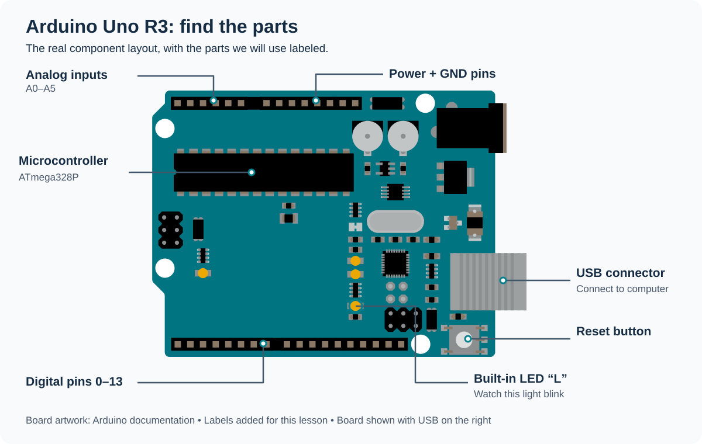
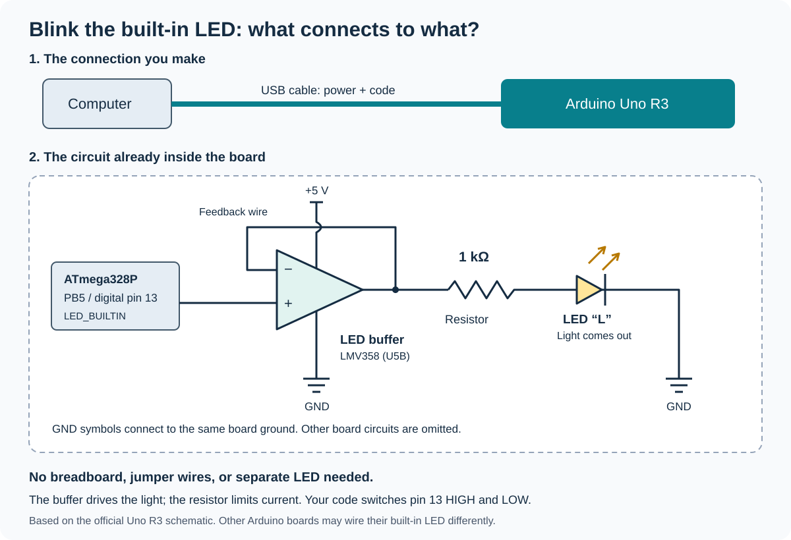
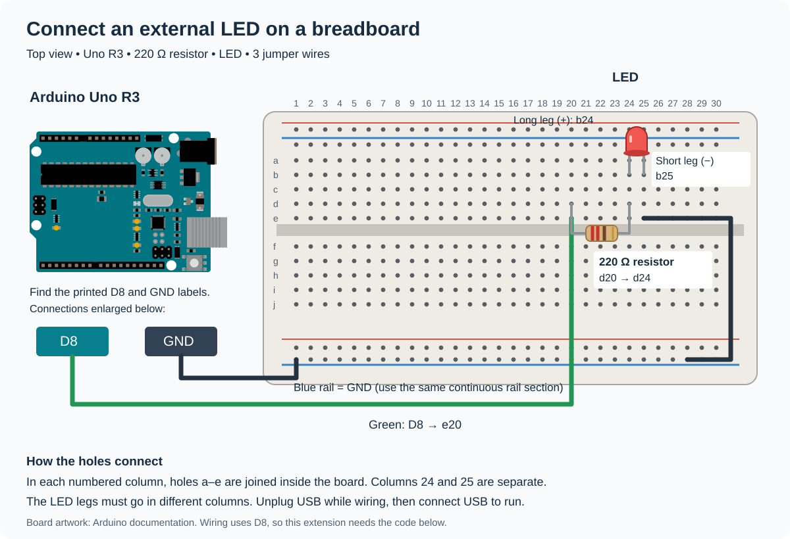

# Arduino basics: blink an LED

An Arduino board is a small programmable electronic board. Its **microcontroller** is a tiny computer that follows your instructions. It can read inputs, such as a button or a sensor, and control outputs, such as a light. Later, our robot will use inputs to decide how to move.

## Meet the board



This detailed board illustration comes from [Arduino’s official Uno R3 documentation](https://docs.arduino.cc/hardware/uno-rev3/), with labels added for this lesson. The USB connector is on the right in this view; your board may look slightly different.

Look for these parts on your board:

- **USB connector:** connects the board to your computer to send it a program and provide power.
- **Microcontroller:** runs your program.
- **Digital pins:** numbered connections that can read or send HIGH and LOW signals.
- **Analog input pins:** often labeled `A0`, `A1`, and so on; these can measure changing sensor signals.
- **Power and GND pins:** provide power connections and ground, the reference for the circuit.
- **Reset button:** starts the program over.
- **Built-in LED:** a small light we can control without adding wires. On an Arduino Uno, look for the LED labeled **L**.

This lesson uses an Arduino Uno or a similar board with a built-in LED supported by `LED_BUILTIN`. The board's shape and labels may differ. `LED_BUILTIN` is the name Arduino uses for that LED's pin. See Arduino's [official Blink example](https://docs.arduino.cc/built-in-examples/basics/Blink/) for board details.

## What you need

- An Arduino board with a built-in LED.
- A USB cable that can carry data, not just charge.
- A computer with the [Arduino IDE](https://www.arduino.cc/en/software/) installed.

The IDE is the app where you write code and send it to the board. An Arduino program is called a **sketch**. For this exercise, the built-in LED needs no extra wiring.

## The built-in LED circuit



The top diagram shows the USB cable you connect. The lower diagram shows the circuit already connected inside the Uno R3. Your program controls the pin 13 signal, an on-board buffer drives the LED, and a resistor limits the current. **You do not need to build this circuit or add any wires.** Just connect the USB cable.

This is a simplified teaching diagram based on the [official Uno R3 schematic](https://docs.arduino.cc/resources/schematics/A000066-schematics.pdf). The buffer’s power and ground connections are shown; other board circuitry is omitted; other Arduino models may use a different LED circuit.

## The two parts of a sketch

```cpp
void setup() {
    // Runs once when the board starts or resets.
}

void loop() {
    // Runs again and again after setup finishes.
}
```

Both are functions. `void` means they do not return an answer. Arduino calls them for you, so you do not write `main()`.

These commands will help you control the LED:

| Command | What it does |
| --- | --- |
| `pinMode(LED_BUILTIN, OUTPUT);` | Sets the LED pin to send an output signal. Put this in `setup()`. |
| `digitalWrite(LED_BUILTIN, HIGH);` | Turns the Uno's built-in LED on. |
| `digitalWrite(LED_BUILTIN, LOW);` | Turns the Uno's built-in LED off. |
| `delay(500);` | Waits for 500 milliseconds, or half a second. |

There are **1,000 milliseconds in one second**. During `delay()`, the sketch waits before moving to the next line.

## Exercise: make the LED blink

One complete blink means **on, then off**. The time spent on plus the time spent off makes one complete cycle.

### Part 1: once per second

Complete the two `TODO` lines below. Make the LED stay on for **500 milliseconds** and off for **500 milliseconds**. That adds up to one second per blink.

```cpp
void setup() {
    pinMode(LED_BUILTIN, OUTPUT);
}

void loop() {
    digitalWrite(LED_BUILTIN, HIGH);
    // TODO: Add a delay to keep the LED on for half a second.

    digitalWrite(LED_BUILTIN, LOW);
    // TODO: Add a delay to keep the LED off for half a second.
}
```

Upload your completed sketch using the steps below. Watch the LED: it should start a new blink about once each second.

### Part 2: once every 3 seconds

Change your sketch so the LED stays on for **1,500 milliseconds** and off for **1,500 milliseconds**. Upload it again.

The complete cycle now takes `1500 + 1500 = 3000` milliseconds, or 3 seconds. The blinking should look slower.

**Check your understanding:** If the LED stays on for 1 second and off for 1 second, how long is one complete blink?

## Send your sketch to the board

1. Connect the board to your computer with the USB cable.
2. Open the Arduino IDE and create a new sketch.
3. Replace the code in the editor with your completed sketch from Part 1.
4. Select your board and its port using the board selector. Choose the model you actually have. If prompted, install its board support package.
5. Click **Verify** (the checkmark) to check your code. If there is an error, check spelling, parentheses, and semicolons.
6. Click **Upload** (the right arrow) to send the sketch to the board. Wait for it to finish, then watch the built-in LED.
7. For Part 2, edit the two delay values and click **Upload** again.

The sketch keeps running while the board has power. Uploading a new sketch replaces the previous one. These steps follow Arduino's [upload guide](https://support.arduino.cc/hc/en-us/articles/4733418441116-Upload-a-sketch-in-Arduino-IDE).

## Check your answers

Try both parts before opening the answers below.

<details>
<summary>Show the completed sketch and timing answers</summary>

For Part 1:

```cpp
void setup() {
    pinMode(LED_BUILTIN, OUTPUT);
}

void loop() {
    digitalWrite(LED_BUILTIN, HIGH);
    delay(500);
    digitalWrite(LED_BUILTIN, LOW);
    delay(500);
}
```

For Part 2, replace **both** `delay(500);` lines with `delay(1500);`.

The understanding-check answer is **2 seconds**: 1 second on plus 1 second off.

</details>

## Try it on a breadboard: an external LED

The first exercise uses the LED already on the board. For this optional extension, build a circuit with a separate LED on a breadboard. We will use **digital pin 8 (D8)** to control it.



A breadboard lets you connect components without soldering. In each numbered column, the five holes **a–e** connect internally. The five holes **f–j** form a separate group across the center gap. Neighboring numbered columns are not connected. The long side rails distribute power or ground; some boards split these rails in the middle.

### Parts and connections

Use an Uno R3, a breadboard, a regular LED, a **220 Ω resistor**, and three jumper wires. Keep the resistor in the circuit to limit the LED's current. Arduino's [Blink guide](https://docs.arduino.cc/built-in-examples/basics/Blink/) also explains using an external LED and resistor.

Unplug USB while making these connections. The diagram uses example hole numbers; equivalent connected holes also work.

| Part | Connect it here |
| --- | --- |
| Green jumper | Arduino **D8** to **e20** |
| 220 Ω resistor | One end in **d20**, the other in **d24**; either direction works |
| LED long leg, anode (+) | **b24** |
| LED short leg, cathode (−) | **b25**; the flat side of the LED body also marks the cathode |
| Short black jumper | **e25** to the blue **− rail** |
| Ground jumper | Arduino **GND** to the same continuous section of the blue **− rail** |

The path is **D8 → resistor → LED → GND**. The LED legs must be in different numbered columns. The breadboard's blue line is only a label: connecting it to Arduino GND makes it the ground rail. This circuit does not need a wire from the Arduino's 5 V pin.

### Blink your external LED

Upload this sketch after checking the connections and reconnecting USB. It uses `8` instead of `LED_BUILTIN` to select the external LED's pin.

```cpp
int ledPin = 8;

void setup() {
    pinMode(ledPin, OUTPUT);
}

void loop() {
    digitalWrite(ledPin, HIGH);
    delay(500);
    digitalWrite(ledPin, LOW);
    delay(500);
}
```

The external LED blinks once per second. Change **both** delays to `1500` and upload again to blink once every 3 seconds.

If it does not light, unplug USB and check the LED direction, hole numbers, and ground connection. If your breadboard has split power rails, put both ground wires in the same continuous section.
